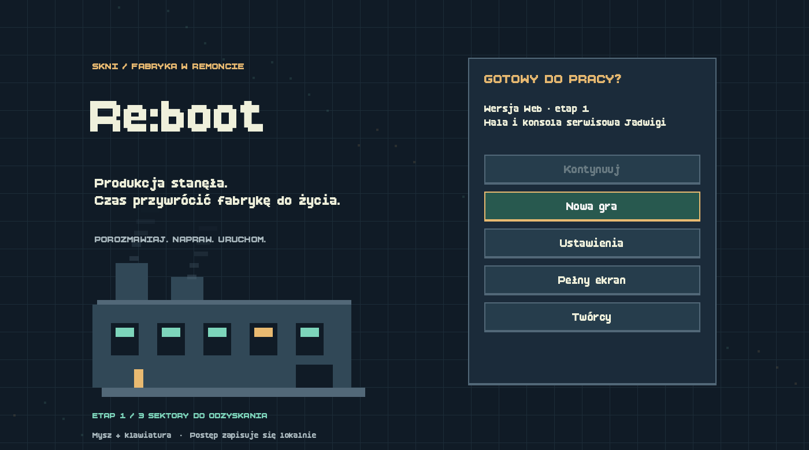
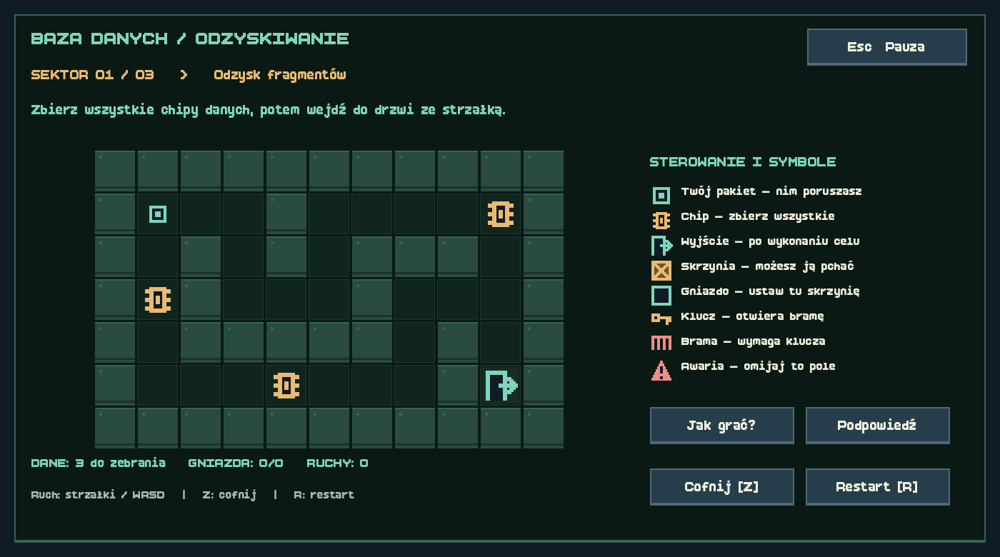

# Re:boot Web

Osobny projekt przeglądarkowego portu Re:boot. **Etap 1 jest grywalny:** menu, oryginalna hala fabryczna, rozmowa z Jadwigą i trzy sektory konsoli serwisowej. Runtime korzysta wyłącznie z GDScript; nie wymaga C# ani .NET.

Szczegółowa lista elementów gotowych w 100%, częściowych i nieruszonych: [STATUS_PORTU.md](STATUS_PORTU.md).



## Zagraj lokalnie

Pliki wynikowe w `builds/` oraz lokalne narzędzia w `.tools/` nie są przechowywane w Git. Po sklonowaniu repozytorium najpierw wykonaj eksport zgodnie z sekcją „Praca nad projektem”. Gotowy eksport powstaje w `builds/web/`. Następnie uruchom w folderze projektu:

```sh
python3 tools/serve.py
```

Otwórz http://127.0.0.1:8060. Serwer nasłuchuje tylko na tym komputerze. Nie otwieraj `index.html` przez `file://` — WebAssembly i zasoby wymagają serwera HTTP.

`builds/reboot-web.zip` zawiera gotową stronę z `index.html` w katalogu głównym. Można ją później umieścić na hostingu statycznym z HTTPS i obsługą MIME `application/wasm`. Gra nie została opublikowana publicznie. Eksport działa bez wątków i nie wymaga nagłówków COOP/COEP. Kompresja HTTP gzip/Brotli skróci pierwsze pobieranie.

## Co działa

- Menu, nowa gra z potwierdzeniem zastąpienia zapisu, kontynuacja, ustawienia muzyki i efektów, pełny ekran, oryginalne napisy autorów.
- Oryginalna mapa, postacie, wyszukiwanie drogi po kliknięciu, kamera i przezroczystość ścian zasłaniających gracza.
- Rozmowa z Jadwigą, odblokowanie bazy, dziennik celu, pauza i powrót do hali.
- Wszystkie trzy oryginalne mapy konsoli, chipy danych, skrzynie, gniazda, klucz, brama, zagrożenia, cofanie, restart, instrukcja i podpowiedzi.
- Zapis ukończonych sektorów, zadania i pozycji gracza; kopia zapasowa oraz walidacja przy odczycie. Po wczytaniu wracasz na halę, a konsola zaczyna od następnego nieukończonego sektora.
- Dwie kompresowane ścieżki muzyczne na każdą z trzech lokalizacji i efekty z oryginalnej gry.



## Sterowanie

| Czynność | Sterowanie |
| --- | --- |
| Ruch po hali | Kliknij podłogę |
| Rozmowa / maszyna | Podejdź i naciśnij E |
| Dalszy dialog | E, Enter lub przycisk Dalej |
| Dziennik / pomoc | J / K |
| Pauza / zamknięcie okna | Esc |
| Ruch w konsoli | WASD, strzałki lub klik sąsiedniego pola |
| Cofnięcie / restart sektora | Z / R |

## Zakres pierwszego etapu

To część pełnej gry. Elektronika, wycinarka, robot oraz pełny łańcuch fabularny i zakończenie pozostają do przeniesienia. W tej wersji Jadwiga jest dostępna od początku, a wstęp i cel kierują do jej zadania. Pozostałe stanowiska informują o zakresie wersji Web. To celowa zmiana kolejności na potrzeby grywalnego etapu, bez przyznawania fikcyjnego postępu w pozostałych zadaniach.

Zapis jest lokalny dla przeglądarki i adresu strony (Godot `user://`, IndexedDB), bez synchronizacji między komputerami. Usunięcie danych strony usuwa zapis. Zapisujemy ukończone sektory, nie każdy ruch w niedokończonym sektorze. Ta wersja wymaga myszy i klawiatury; sterowanie telefonem pozostaje do przygotowania. Zweryfikowano Chrome na macOS; Safari i Firefox wymagają osobnych testów.

## Praca nad projektem

Otwórz `project.godot` w **Godot 4.5.1 Standard**, bez .NET. Na komputerze, na którym powstał port, edytor Standard znajduje się w `.tools/Godot.app`. Po sklonowaniu repozytorium użyj własnej instalacji Godota i ustaw `GODOT_BIN` zgodnie z przykładem poniżej. Folder `.tools` nie jest częścią repozytorium.

```sh
bash tools/build_web.sh
```

Na innym komputerze ustaw ścieżkę do Godota Standard, np.:

```sh
GODOT_BIN="/ścieżka/do/Godot" bash tools/build_web.sh
```

Skrypt pobiera brakujące szablony Web 4.5.1 z oficjalnego wydania Godota, importuje zasoby i eksportuje do `builds/web`. Szablony mają tę samą wersję co edytor. Edytor .NET nie eksportuje do Web nawet po usunięciu wszystkich skryptów C#.

Układ projektu:

- `scripts/` — runtime, UI, stan zapisu, mapa i konsola w GDScript.
- `scenes/`, `Prefabs/`, `Art/`, `IMG/`, `Dialogue/NPC/` — zachowane zasoby i scena hali po usunięciu zależności C#.
- `data/` — oryginalne mapy i pikselowe symbole konsoli, dialogi i autorzy.
- `audio/` — muzyka w Ogg Vorbis oraz efekty WAV.
- `tests/` — regresja reguł, progresji, zapisu i przepływu między scenami.
- `tools/` — pobranie szablonów, eksport, lokalny serwer.

## Weryfikacja

```sh
.tools/Godot.app/Contents/MacOS/Godot --headless --path . tests/regression.tscn
```

46 sprawdzeń: oryginalne rozwiązania trzech map, ściany, klucz, skrzynie, cofanie, warunki wyjścia, dostępność drogi do Jadwigi, dialog, blokady modali, kolejne sektory, powrót do hali, raport i odzyskanie uszkodzonego zapisu z kopii. Testy używają osobnego pliku zapisu.

Przejście eksportu w Chrome obejmowało wejście z menu, rzeczywisty ruch po hali, rozmowę, trzy sektory, odświeżenie po pierwszym sektorze, wczytanie i kontynuację od drugiego, powrót i raport u Jadwigi. Brak błędów konsoli podczas tego przebiegu. Zrzuty w `docs/` pochodzą z eksportu Web.

## Źródło i kolejne etapy

Źródło: [Pequtek2/re-boot](https://github.com/Pequtek2/re-boot), commit `5f0de6713ae6668480d8577a95733379cf078cc8`. Projekt desktopowy w sąsiednim folderze `re-boot` pozostaje niezależny. Autorzy oryginału są wymienieni w `data/credits.txt` i w menu gry.

Kolejne etapy: robot i kompilator klocków z pętlami, Cyber-Elektryk, wycinarka, pełny system zadań i zakończenie, potem testy dodatkowych przeglądarek i publikacja.
